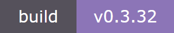
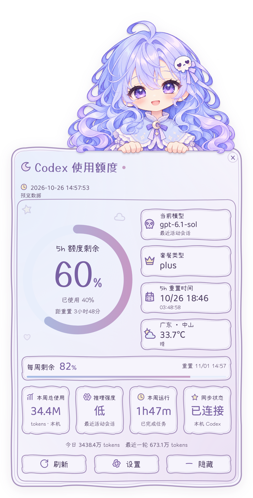
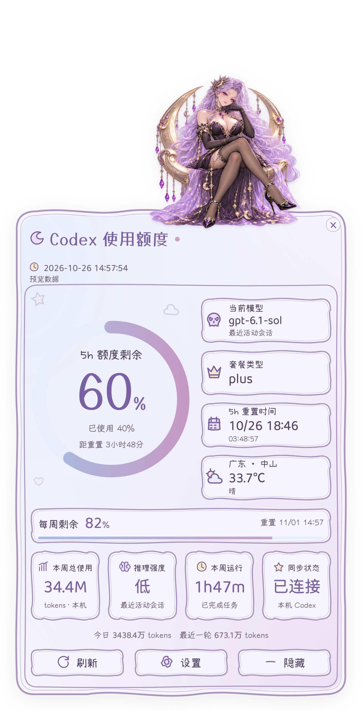
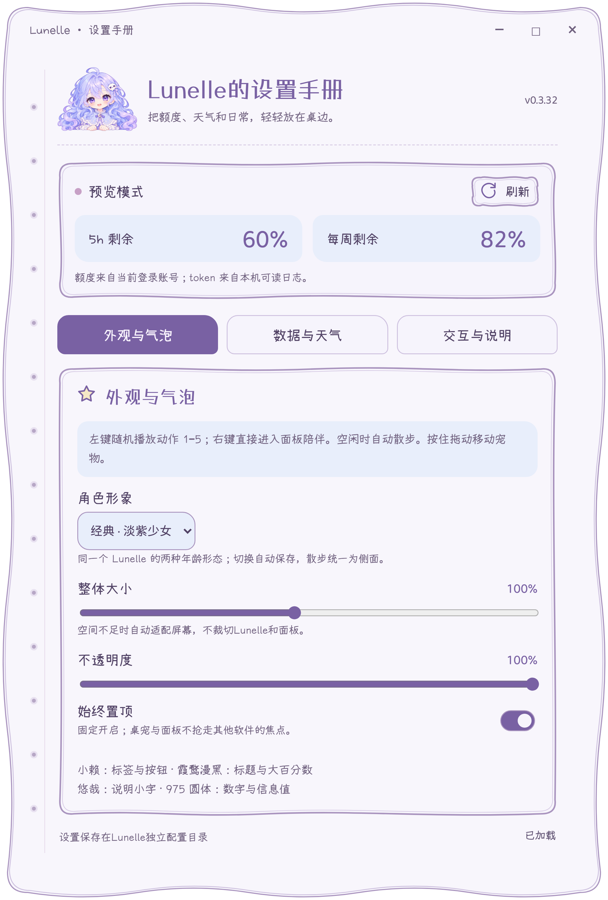
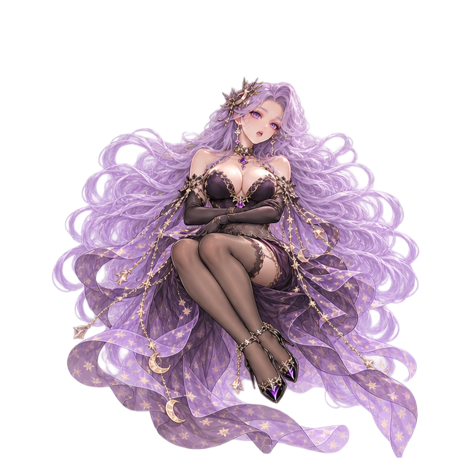
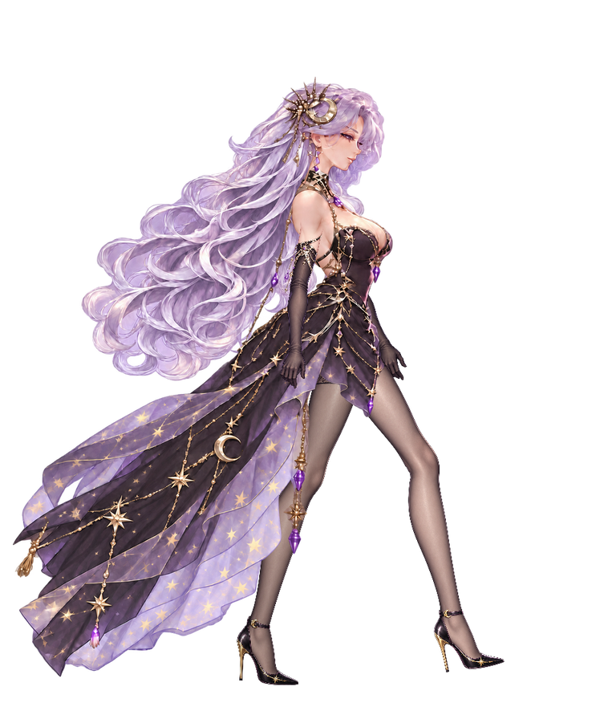

<div align="center">

<br />


<br />

<p><sub>A DESKTOP COMPANION · 一册桌边手账</sub></p>

# Lunelle

### 在桌面的一角，留一小片月色。

<p>Lunelle 抱着星星，坐在你工作的地方。<br />左键，回应一个小动作；右键，陪你翻开手账。</p>


<br />

<p><a href="docs/releases/v0.3.32.md"></a> <a href="#download"></a> <a href="LICENSE"></a></p>

**[下载 Windows 版](#download)　·　[翻开手账](#journal)　·　[看看她的日常](#motion)　·　[设计画册](docs/DESIGN.md)**

<sub>Windows x64 · 简体中文 · 本地只读数据 · 无需 API key</sub>

<br /><br />

</div>

---

工作留在窗口里，陪伴留在桌边。Lunelle 将一只会回应的桌宠与一本 Codex 使用手账放在一起：平时安静坐着，偶尔起身散步；需要时，额度、重置时间与本机用量就在手边。

淡紫卷发、层叠裙摆与手绘纸边，延续着同一组颜色。陪伴与信息各有位置，日常操作也只需几次轻点。

<table>
<tr>
<td width="33%" valign="top"><b>同一个她，两个年纪</b><br /><br />从抱着星星的少女，到身着暗月长裙的成年形态；在设置里随时切换。</td>
<td width="34%" valign="top"><b>一页看清工作日常</b><br /><br />Codex 额度、重置时间、本机用量与城市天气，收在同一本手账里。</td>
<td width="33%" valign="top"><b>桌边的小小回应</b><br /><br />左键互动，拖动换个位置，右键展开陪伴；安静片刻，她会继续散步。</td>
</tr>
</table>

<a id="character"></a>
## 01 · 同一个她，不同的年纪

星星抱枕、骷髅发饰和月亮鞋，是她年少时的模样；银紫卷发、暗月长裙与月牙座，属于长大后的她。两种外观延续同一个 Lunelle 的角色设定，各自保留服装、配饰与身体比例。

<p align="center"><a href="docs/images/readme/cover.png"></a></p>

<p align="center"><a href="docs/images/ages-side-walk.webp"></a></p>

<p align="center"><sub>从年少到长大，同一个她，走过桌边的一小段路。<br />实际行走展示 · 点击查看原尺寸</sub></p>

| 形态 | 留在桌边的模样 |
| :--- | :--- |
| **经典 · 淡紫少女** | 淡紫卷发、骷髅发饰、层叠裙装、白袜与月亮鞋。休息时抱着星星，散步时放下抱枕。 |
| **御姐 · 暗月女王** | 银紫长卷发、月亮饰物与暗月长裙。休息时坐在月牙座上，展开手账后使用专属陪伴坐姿。 |

在 **「设置手册 → 外观 → 角色形象」** 中选择，立即切换并自动保存。两种形态均支持呼吸、眨眼、歪头、点头、挥手、拖放落地、散步与面板陪伴。

坐下时，各有自己的姿态；走动时，延续同样的节奏。你可以随时切换，选一位陪今天的自己。

<a id="journal"></a>
## 02 · 右键，翻开一页手账

还剩多少额度，何时重置，今天用了多少 token——这些工作中的小问题，都可以在同一页里找到答案。经典形态趴在纸边，成年形态坐在月牙座上，陪你读完这一页。

<table>
<tr><th width="28%">额度手账 · 萝莉</th><th width="28%">额度手账 · 御姐</th><th width="44%">设置手册</th></tr>
<tr>
<td align="center" valign="middle"><a href="docs/images/readme/panel-classic.png"></a></td>
<td align="center" valign="middle"><a href="docs/images/readme/panel-queen.png"></a></td>
<td align="center" valign="middle"><a href="docs/images/readme/settings-full.png"></a></td>
</tr>
</table>

<p align="center"><sub>两种陪伴姿态，同一本额度手账。设置页完整展示，点击图片可查看高清原图。</sub></p>

| 一眼可见 | 具体内容 |
| :--- | :--- |
| **Codex 额度** | 5 小时与每周剩余比例、重置时间和倒计时 |
| **本机用量** | 今日、本周与最近一轮 token，已完成任务运行时长 |
| **最近会话** | 模型、推理强度与套餐信息 |
| **城市天气** | 手动选择城市的温度与天气，可随时关闭 |

纸边沿着手绘曲线展开，浅蓝色信息块落在淡紫底色上。标题、数字与说明使用不同字迹；读取状态留在固定位置，翻阅时始终找得到操作按钮。

右键宠物或从托盘选择「动作 8 · 面板陪伴」即可展开。点击纸边的 **×**、按 **Esc** 或点击面板外收起；移开鼠标不会自动合上手账。

<a id="motion"></a>
## 03 · 她有自己的桌边日常

轻点一下，她会先停稳，再回应一次小动作。按住拖动，她收起双腿；松手后，裙摆轻轻落回坐姿。每次互动都会重新留出一段安静的休息时间，之后再继续散步。

<table>
<tr><th>动作</th><th width="44%">经典 · 淡紫少女</th><th width="44%">御姐 · 暗月女王</th></tr>
<tr><td align="center" valign="middle"><b>01</b><br />待机呼吸</td><td align="center" valign="middle"><a href="docs/images/readme/classic-breathe.png"></a></td><td align="center" valign="middle"><a href="docs/images/readme/queen-breathe.png"></a></td></tr>
<tr><td align="center" valign="middle"><b>02</b><br />眨眼</td><td align="center" valign="middle"><a href="docs/images/readme/classic-blink.png"></a></td><td align="center" valign="middle"><a href="docs/images/readme/queen-blink.png"></a></td></tr>
<tr><td align="center" valign="middle"><b>03</b><br />歪头</td><td align="center" valign="middle"><a href="docs/images/readme/classic-tilt.png"></a></td><td align="center" valign="middle"><a href="docs/images/readme/queen-tilt.png"></a></td></tr>
<tr><td align="center" valign="middle"><b>04</b><br />点头</td><td align="center" valign="middle"><a href="docs/images/readme/classic-nod.png"></a></td><td align="center" valign="middle"><a href="docs/images/readme/queen-nod.png"></a></td></tr>
<tr><td align="center" valign="middle"><b>05</b><br />挥手</td><td align="center" valign="middle"><a href="docs/images/readme/classic-wave.png"></a></td><td align="center" valign="middle"><a href="docs/images/readme/queen-wave.png"></a></td></tr>
<tr><td align="center" valign="middle"><b>06</b><br />拎起与落地</td><td align="center" valign="middle"><a href="docs/images/readme/classic-lift.png"></a><a href="docs/images/readme/classic-land.png"></a><br /><sub>拎起 / 落地</sub></td><td align="center" valign="middle"><a href="docs/images/readme/queen-lift.png"></a><a href="docs/images/readme/queen-land.png"></a><br /><sub>拎起 / 落地</sub></td></tr>
<tr><td align="center" valign="middle"><b>07</b><br />附近散步</td><td align="center" valign="middle"><a href="assets/characters/classic/shared-walk/walk.webp"></a></td><td align="center" valign="middle"><a href="assets/characters/queen/v2/walk.webp"></a></td></tr>
<tr><td align="center" valign="middle"><b>08</b><br />面板陪伴</td><td align="center" valign="middle"><a href="docs/images/readme/classic-companion.png"></a></td><td align="center" valign="middle"><a href="docs/images/readme/queen-companion.png"></a></td></tr>
</table>

<p align="center"><sub>两种形态的八类动作完整展开。静态图取自实际渲染器，记录动作相位；散步展示完整循环。点击任一图片查看原尺寸。</sub></p>

她大部分时间坐着陪伴。空闲约 **15–25 秒** 后，会在当前屏幕内散步一趟，约 **8–15 秒**，再回到坐姿。两种年龄形态都采用侧面行走，换腿、落脚与摆臂节奏一致。

鼠标从身边经过，她继续走动；点击、拖动或翻开手账，她便把注意力交还给你。临时散步不会覆盖手动保存的位置。

<details>
<summary>展开八类动作与触发方式</summary>

| 动作 | 如何触发 |
| :--- | :--- |
| 01 · 呼吸 | 左键随机回应；坐姿也有轻微呼吸 |
| 02 · 眨眼 | 左键随机回应；空闲坐姿也会眨眼 |
| 03 · 歪头 | 左键随机回应；轻轻倾斜后回正 |
| 04 · 点头 | 左键随机回应；配合闭眼与回正 |
| 05 · 挥手 | 左键随机回应；抬手招呼，再收回 |
| 06 · 拎起与落地 | 按住并拖动；松手缓冲、回坐 |
| 07 · 附近散步 | 默认开启；空闲后在当前显示器工作区内走动 |
| 08 · 面板陪伴 | 右键直接展开，也可从托盘或设置进入 |

左键动作会避开上一次回应。连续点击先收尾再接入新动作，拖动优先接管；落地完成后重新开始休息计时。打开手账、设置或隐藏桌宠时暂停走动。

在 **「设置 → 交互与说明」** 中可逐项预览动作，也可切换原地活动与全屏散步。

[动作与播放说明](docs/ANIMATION.md) · [完整设计画册](docs/DESIGN.md)

</details>

<a id="download"></a>
## 04 · 邀请她来到桌面

**[获取已发布的 Windows x64 安装包 →](https://github.com/Timiocoisin/Lunelle/releases/latest)**

安装也从一本手账开始。花枝沿着曲线纸边舒展，Lunelle 在左页挥手、阅读或安静等待；右页依次展开许可、安装位置与进度。选好位置，她就可以留在桌边。

<p align="center"><a href="docs/design/installer-final/01.png"></a></p>

1. **准备 Codex** — 安装并登录 Codex，确认本机可运行其 `app-server`。
2. **翻开安装手账** — 选择安装位置与快捷方式。安装包自带运行时，无需另装 Node.js。
3. **与她见面** — 从桌面或开始菜单打开 Lunelle，右键宠物即可展开额度手账。

覆盖升级保留已有偏好设置。首次打开安装包需要准备界面运行时，后续打开同一安装包会复用缓存。

<details>
<summary>版本、校验与安装说明</summary>

本文与本地构建对应 **v0.3.32**，已发布版本以发布页为准。

- 本地安装包：`installers/Lunelle-Setup-0.3.32-x64.exe`
- [v0.3.32 更新说明](docs/releases/v0.3.32.md) · [SHA-256 清单](docs/releases/SHA256SUMS-v0.3.32.txt)
- [六页安装界面](docs/design/installer-final/README.md) · [安装器验证记录](docs/INSTALLER-VALIDATION.md)
- [安装器说明与构建方法](installer-ui/README.md)

安装面向当前 Windows 用户，可选择安装目录、桌面与开始菜单快捷方式。升级时选择原目录，已有偏好设置会保留。便携运行需保留完整程序目录，不能单独复制 EXE。

当前提供 Windows x64 构建；安装包尚未配置代码签名。界面缓存位于 `%LOCALAPPDATA%/LunelleSetupCache`，与桌宠偏好目录分开。

</details>

### 相处的几个小习惯

| 操作 | 回应 |
| :--- | :--- |
| **左键轻点** | 随机播放呼吸、眨眼、歪头、点头或挥手 |
| **按住拖动** | 移动她的位置，松手后落地并保存 |
| **右键宠物** | 展开面板陪伴 |
| **× / Esc / 点击面板外** | 收起手账 |
| **Ctrl + Alt + X** | 显示或隐藏桌宠 |
| **托盘菜单** | 显示、设置、陪伴或退出 |

<a id="data"></a>
## 05 · 每个数字，都有来处

额度取自当前登录的 Codex 账号，用量取自本机可读的会话日志。Lunelle 无需 API key；读取过程不发送提示词，也不发起模型推理调用。

| 信息 | 来源与边界 |
| :--- | :--- |
| 5h / 每周额度 | 官方本地 `app-server` 的只读接口 |
| token | 本机 `sessions` 与 `archived_sessions` 日志；同一会话去重，按本地周一统计本周 |
| 模型 / 推理强度 | 最近活动会话元数据，不保证是前台会话 |
| 本周运行时长 | 已完成任务时间区间的并集，不等于纯推理耗时 |
| 天气 | Open-Meteo，按手动选择的城市查询 |

本机日志可能不完整，也可能涵盖多个账号；本机用量不等于完整账号账单。额度通知通过本地连接接收，日志变化也会触发更新；断线后自动重连。

<details>
<summary>本地数据与隐私</summary>

- 不直接读取或复制 `auth.json`，额度接口使用只读白名单。
- 日志在工作线程解析，只提取元数据与计数，不上传原始对话。
- 天气查询发送所选城市名或坐标，不使用 GPS 或 IP 定位。
- 面板展开期间，Windows 辅助进程只检测外部鼠标点击，不监听键盘或记录点击历史。
- 偏好保存在 `%APPDATA%/XingyueDesktop`，升级保留原目录。
- 提交问题前，请移除账号信息、凭据、个人路径与对话内容。

</details>

<a id="development"></a>
## 06 · 从源码开始

需要 **Node.js 22+**，以及已安装、登录的 Codex。

```sh
git clone https://github.com/Timiocoisin/Lunelle.git
cd Lunelle
npm ci
npm start
```

<details>
<summary>构建、验证与项目结构</summary>

```sh
npm run preview                  # 演示数据，不访问账号或本机会话
npm test                         # 数据、配置、交互与动画时间轴
npm run test:ui                  # 隔离配置的 Electron 界面检查
npm run build -- --with-artwork   # 含角色资源的便携版
npm run installer                # Windows 六页安装向导
npm run test:installer           # 安装界面、许可与预览隔离检查
```

| 目录 | 内容 |
| :--- | :--- |
| `app/` | 窗口、拖动、自动活动与只读数据接口 |
| `ui/` | 手账、设置与角色动画 |
| `installer-ui/` | 六页安装手账与安装引擎桥接 |
| `assets/` | 角色、图标、字体与许可 |
| `scripts/` | 构建、素材导出与验证 |
| `tests/` | 数据、交互、动画与窗口检查 |
| `docs/` | 设计画册、运行展示与版本记录 |

字体与动画本地加载。打包采用明确文件清单，不包含个人配置、凭据或会话日志。界面截图与预览使用隔离配置及合成演示数据。

[素材与生成记录](ASSETS.md) · [动作实现说明](docs/ANIMATION.md) · [安装器构建](installer-ui/README.md)

</details>

### 字迹与作品归属

小赖写下标签，霞鹜漫黑留下标题，悠哉承接说明，霞鹜 975 圆体呈现数字。四种字迹与淡紫、浅蓝、纸张白，共同构成这册手账。

| 内容 | 许可 |
| :--- | :--- |
| 项目代码 | [MIT](LICENSE) |
| 角色、动作设计与图标 | 单独保留权利，不纳入代码 MIT；见 [ASSETS.md](ASSETS.md) |
| 字体 | 各自的 SIL OFL 1.1；见 [字体许可](assets/fonts/licenses) |
| 依赖与数据服务 | [THIRD_PARTY.md](THIRD_PARTY.md) |

Lunelle 是独立社区项目，与 OpenAI 无隶属或背书关系。

---

<div align="center">


<sub>星星抱在怀里，手账留在桌边。</sub>

[下载](#download)　·　[画册](docs/DESIGN.md)　·　[反馈](https://github.com/Timiocoisin/Lunelle/issues)

</div>
