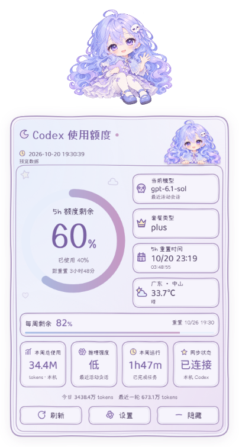
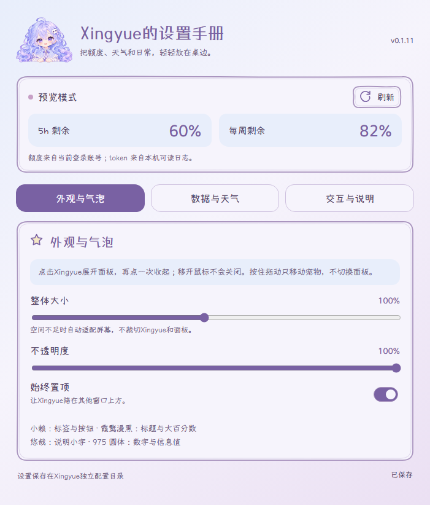

<div align="center">


# Xingyue

**让额度有迹可循，让桌面多一点陪伴。**

A pastel desktop companion for your Codex workflow.

[](https://github.com/Timiocoisin/xingyue-desktop/releases/latest)


[](LICENSE)

一只浅紫色的桌面伙伴，一本随手展开的 Codex 使用手账。<br />
剩余额度、重置倒计时、本机 token 统计与天气，轻轻放在桌边。

**[下载安装](https://github.com/Timiocoisin/xingyue-desktop/releases/latest) · [界面预览](#preview) · [使用方式](#controls) · [源码运行](#development) · [反馈问题](https://github.com/Timiocoisin/xingyue-desktop/issues)**

</div>

---

<a id="preview"></a>
## 在桌边，随时看一眼

平时是一只可以拖动的桌宠，单击后展开手账面板。淡紫与浅蓝的配色、手写字体、纸张边线和角色插画，贯穿面板、设置页与应用图标。

<table>
  <tr>
    <th width="43%">额度手账</th>
    <th width="57%">外观设置</th>
  </tr>
  <tr>
    <td align="center" valign="top"></td>
    <td align="center" valign="top"></td>
  </tr>
  <tr>
    <td align="center">展开时看数据，收起后留陪伴。</td>
    <td align="center">调整大小、透明度与置顶方式。</td>
  </tr>
</table>

> 截图来自应用的隔离预览模式，额度、模型、用量与天气均为演示数据，不代表真实账号。界面目前为简体中文。

<a id="download"></a>
## 下载与安装

| 平台 | 下载 | 状态 |
| :--- | :--- | :--- |
| Windows x64 | **[下载 v0.1.11 安装包](https://github.com/Timiocoisin/xingyue-desktop/releases/download/v0.1.11/Xingyue-Setup-0.1.11-x64.exe)** | 已构建并完成本地验证 |
| 其他版本 | [查看全部 Releases](https://github.com/Timiocoisin/xingyue-desktop/releases) | 更新说明与安装附件 |
| macOS / Linux | 暂不提供安装包 | 完整桌面行为尚未验证 |

1. 安装并登录官方 Codex，确保本机可以使用 Codex 的 `app-server`。
2. 运行安装包，按向导选择安装位置。安装版自带运行时，**不需要另装 Node.js 或 npm**。
3. 从桌面或开始菜单打开 **Xingyue**，单击宠物即可展开额度面板。

支持当前用户安装、桌面与开始菜单快捷方式，以及系统“已安装的应用”中的卸载入口。覆盖升级保留设置；卸载默认也保留配置，便于重新安装。

<details>
<summary>安装与启动说明</summary>

- 安装包尚未配置代码签名，Windows 可能显示未知发布者或 SmartScreen 提示。请从本仓库 Releases 获取安装包。
- 暂时不想显示桌宠时，可使用托盘或 `Ctrl + Alt + X` 隐藏；退出应用请使用托盘菜单。
- 额度无法读取时，先确认 Codex 已登录并可正常运行；必要时在设置页指定 Codex 可执行文件路径。
- 便携版需要复制整个 `dist/Xingyue-win32-x64/` 目录，不能只复制其中的 EXE。

</details>

## 能做什么

| 功能 | 具体表现 |
| :--- | :--- |
| **额度一眼可见** | 5 小时与每周剩余百分比、已用比例、重置时间及倒计时 |
| **本机用量手账** | 今日、本周、最近一轮 token；本周已完成任务的运行时长 |
| **最近会话信息** | 最近活动会话的模型与推理强度，以及当前额度套餐信息 |
| **桌边天气** | 指定城市的温度与天气，可关闭；默认城市为中山 |
| **自由放置** | 拖动宠物移动，记住位置；固定透明画布内位移，面板按空间选择展开方向 |
| **外观调整** | 整体大小、不透明度、始终置顶；本地加载四款手写字体 |
| **手动与定时刷新** | 定时读取，也可单击刷新；异常保留旧值，并提示数据过期或读取失败 |

无需 API key，不发送提示词，不发起模型推理调用。

<a id="controls"></a>
## 怎么用

| 想做的事 | 操作 |
| :--- | :--- |
| 展开 / 收起手账 | 单击宠物；聚焦宠物后按 `Enter` 或 `Space` |
| 移动宠物 | 按住宠物拖动；拖动不会切换面板 |
| 收起面板 | 再次单击宠物、按 `Escape`，或点击宠物和面板以外的位置 |
| 刷新数据 | 面板底部的“刷新”按钮 |
| 打开设置 | 面板“设置”按钮、宠物右键菜单或托盘菜单 |
| 显示 / 隐藏 | `Ctrl + Alt + X`，或单击托盘图标 |
| 退出 | 托盘菜单 → 退出 Xingyue |

移开鼠标不会自动收起已展开的面板。若全局快捷键被其他软件占用，可使用托盘菜单。

## 数据从哪里来

**额度来自当前 Codex 登录账号；token 来自本机可读日志。两者的统计范围不同。**

| 信息 | 来源与统计范围 |
| :--- | :--- |
| 5h / 周额度 | 通过官方本地 `app-server` 的只读 `account/read`、`account/rateLimits/read` 获取，按 300 / 10080 分钟窗口识别 |
| token 统计 | 解析 `CODEX_HOME/sessions` 与 `archived_sessions` 中的会话元数据、计数事件；相同会话去重，周统计从本地时间周一开始 |
| 模型 / 推理强度 | 最近活动会话的元数据，不保证对应当前前台会话 |
| 本周运行时长 | 本周已完成任务时间区间的并集，不是在线时长或纯推理耗时 |
| 天气 | [Open-Meteo](https://open-meteo.com/)，按指定城市查询，缓存 10 分钟 |

日志不完整时，统计也可能不完整。本机 token 合计可能涵盖多个账号，不能当作当前账号账单或跨设备总用量。未知额度不会被填成示例百分比，读取失败会显示状态。

<details>
<summary>本地数据、权限与配置位置</summary>

- 不直接读取或复制 `auth.json`，不向模型发送请求；额度接口使用固定的只读白名单。
- 本地日志解析在工作线程中进行，提取会话元数据与数值事件，不上传原始对话。
- 天气按你填写的城市查询，不使用 GPS 或 IP 定位；城市名或坐标会发送至天气服务。
- Windows 外部点击检测仅在面板展开时运行隐藏的 PowerShell 辅助进程，检查鼠标按键状态；不监听键盘、不记录点击历史，面板收起后停止。
- 设置存放于 `%APPDATA%/XingyueDesktop/preferences.json`，与其他桌宠应用独立，不导入它们的配置。
- 提交 Issue 前，请移除账号信息、凭据、个人路径和对话内容。

</details>

<a id="development"></a>
## 从源码运行

需要 **Node.js 22+** 与已经安装、登录的 Codex。以下命令在仓库根目录执行。

```sh
git clone https://github.com/Timiocoisin/xingyue-desktop.git
cd xingyue-desktop
npm ci
npm start
```

仓库已包含四款字体。需要重新获取字体时执行 `npm run assets`，脚本会校验上游发布文件的 SHA-256。

```sh
npm run preview       # 使用演示数据，不访问账号或本机会话
npm test              # 数据、配置、拖动坐标等回归测试
npm run test:ui       # 隔离配置的 Electron 界面与渲染测试
npm run verify:live   # 显式只读检查真实额度、本机统计及天气
```

### 打包

```sh
npm run build -- --with-artwork   # 生成含角色素材的便携版
npm run installer               # 将便携版制作成 Windows 安装向导
```

便携版输出至 `dist/`，安装包输出至 `installers/`。不带 `--with-artwork` 的默认构建省略完整角色 PNG，使用应用图标作为角色回退。构建按文件清单打包，不包含个人配置、账号凭据、日志或本地测试截图。

角色素材与代码的许可范围不同，二次分发前请阅读 [ASSETS.md](ASSETS.md)。

### 项目结构

```text
app/        主进程、拖动与窗口布局、只读数据接口、日志与天气
ui/         手账面板、设置页、字体与界面交互
assets/     角色、应用图标、字体及字体许可
scripts/    字体获取、资源打包、安装器与只读诊断
tests/      合成日志、坐标回归、隔离界面与原生窗口检查
docs/       展示图片、实现与安装验证记录
```

## 最近更新 · v0.1.11

- **拖动重写**：将宠物移动改为固定透明画布内位移，避免原生窗口移动与角色补偿互相干扰。
- **边界与方向修复**：修复向下拖动反向、屏幕边缘不可达；统一屏幕坐标并覆盖负坐标屏幕用例。
- **渲染调整**：按帧合并位置更新，关闭后台帧率节流，拖动期间固定角色朝向。
- **视觉统一**：软件名称统一为 Xingyue，应用图标采用宠物同款透明半身形象。

本版通过 35 项回归测试、9 组缩放与边缘布局检查、60 帧界面位移检查，以及 120 次原生窗口回归检查。自动检查不等于所有设备上的体验保证，欢迎附上系统缩放比例、显示器配置与复现步骤反馈问题。

[查看完整发布说明 →](https://github.com/Timiocoisin/xingyue-desktop/releases/tag/v0.1.11)

## 设计、致谢与许可

Xingyue 采用淡紫、浅蓝与纸张白的手账风格。小赖负责标签与按钮，霞鹜漫黑负责标题和大号百分数，悠哉负责说明小字，霞鹜 975 圆体负责日期、模型与信息值。字体均本地加载，原始文件与 OFL 许可一并保留。

感谢 [Codex Maid Widget](https://github.com/Feeesack/codex-maid-widget) 在 Codex 桌面伙伴方向上的探索；本 README 参考其“预览 → 下载 → 功能 → 使用 → 数据说明”的信息组织方式，内容与截图均围绕 Xingyue 自身实现编写。

项目经历过参考与修改其他桌宠的阶段。当前仓库的窗口、数据适配器、UI、交互与测试重新编写，未迁移原桌宠项目源码；不作严格洁净室开发声明，第三方来源与授权说明仍予以保留。

| 内容 | 许可与来源 |
| :--- | :--- |
| 项目代码 | [MIT License](LICENSE) |
| 角色插画、应用图标 | 作者提供或为本项目生成，单独保留权利，不纳入代码 MIT 许可；详见 [ASSETS.md](ASSETS.md) |
| 四款字体 | 各自的 SIL OFL 1.1，许可文件见 [assets/fonts/licenses](assets/fonts/licenses) |
| 运行时、依赖与天气数据 | 见 [THIRD_PARTY.md](THIRD_PARTY.md)；天气数据来源为 Open-Meteo |

Xingyue 是独立社区项目，与 OpenAI 无隶属或背书关系。

---

<div align="center">

**Xingyue · 把数据放在桌边，把注意力留给创作。**

[下载](https://github.com/Timiocoisin/xingyue-desktop/releases/latest) · [报告问题](https://github.com/Timiocoisin/xingyue-desktop/issues) · [源码](https://github.com/Timiocoisin/xingyue-desktop)

</div>
