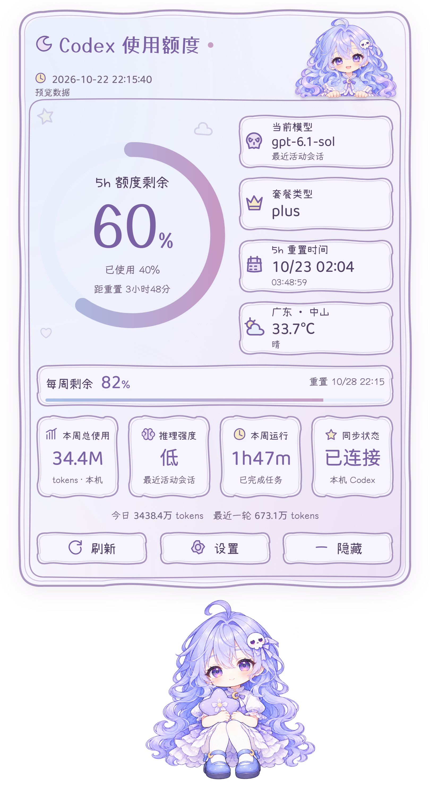
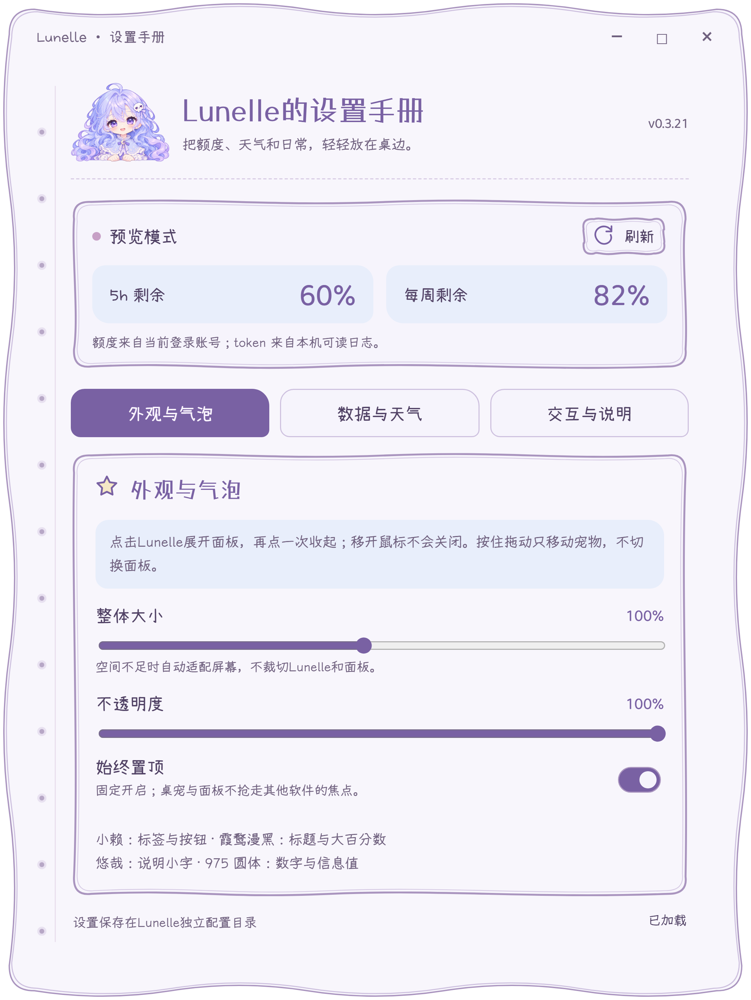
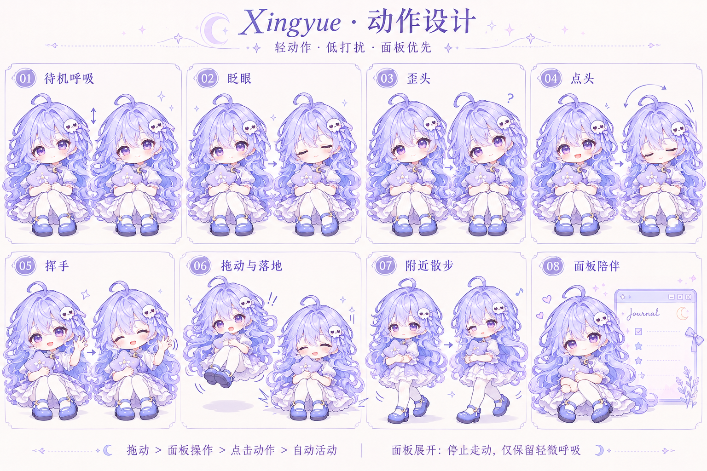

<div align="center">


# Lunelle

**一隅月色，片刻从容。**

淡紫色的桌面伙伴，与一本随手展开的 Codex 使用手账。<br />
额度、天气与日常，安静地放在桌边。

<a href="assets/characters/idle-seated.png"></a>

[](https://github.com/Timiocoisin/Lunelle/releases/latest)

[](LICENSE)

[下载](#download) · [手账](#journal) · [陪伴](#motion) · [设计](#design) · [使用](#controls) · [开发](#development)

</div>

<a id="journal"></a>
## 把信息留在眼前，把注意力留给创作

单击 Lunelle，手账轻轻展开：剩余额度、重置时间、本机使用记录，以及所在城市的天气。再点一下，收起信息，留下抱着星星的她。

<table>
<tr><th>额度手账</th><th>设置手册</th></tr>
<tr>
<td align="center" valign="top"><a href="docs/images/quota-panel-restored-hd.png"></a></td>
<td align="center" valign="top"><a href="docs/images/appearance-settings-restored-hd.png"></a></td>
</tr>
</table>

<sub>界面截图使用隔离演示数据，点击可查看完整图片。当前界面为简体中文。</sub>

| 信息 | 内容 |
| :--- | :--- |
| 额度 | 5 小时与每周剩余比例、重置时间与倒计时 |
| 用量 | 今日、本周与最近一轮 token；已完成任务运行时长 |
| 会话 | 最近活动会话的模型、推理强度与套餐信息 |
| 天气 | 手动选择城市的温度与天气，可随时关闭 |

手绘曲线勾勒纸张，浅蓝与淡紫铺开层次。本地字体、圆角滚动条与无边框设置窗口，让手账融入桌面；读取提示留在固定状态行，操作始终清楚可见。

<a id="motion"></a>
## 小动作，自有节奏

她会抱着星星呼吸，偶尔眨眼；与你招呼时歪头、点头或挥手。被轻轻拎起，再随着松手回到坐姿。打开手账，她便停下散步，在旁边安静陪伴。

| 动作 | 表现 |
| :--- | :--- |
| 呼吸与眨眼 | 轻微起伏，眼皮经过半闭、闭合与睁开的过程 |
| 歪头与点头 | 头肩平缓衔接，短暂停留后回正 |
| 挥手 | 手臂局部摆动，配合眨眼与笑容 |
| 拖动与落地 | 悬空抱膝，松手后缓冲、回坐 |
| 散步 | 抱着星星侧向走动，保留发尾、裙摆与抱枕的轻微跟随 |
| 面板陪伴 | 展开手账时停驻，只保留轻微呼吸 |

### 眨眼之间

<table>
<tr><th>睁眼</th><th>轻轻合眼</th><th>短暂停留</th><th>重新睁开</th></tr>
<tr>
<td align="center"><a href="docs/images/blink-open-hd.png"></a></td>
<td align="center"><a href="docs/images/blink-half-close-hd.png"></a></td>
<td align="center"><a href="docs/images/blink-closed-hd.png"></a></td>
<td align="center"><a href="docs/images/blink-half-open-hd.png"></a></td>
</tr>
</table>

### 给你一点回应

<table>
<tr><th>歪头</th><th>点头</th><th>挥手</th></tr>
<tr>
<td align="center"><a href="docs/images/tilt-head-hd.png"></a></td>
<td align="center"><a href="docs/images/nod-head-hd.png"></a></td>
<td align="center"><a href="docs/images/wave-arm-a-hd.png"></a></td>
</tr>
</table>

### 轻轻拎起，稳稳落下

<table>
<tr><th>悬空抱膝</th><th>落地回坐</th></tr>
<tr>
<td align="center"><a href="docs/images/drag-suspended-design-hd.png"></a></td>
<td align="center"><a href="docs/images/landing-seated-design-hd.png"></a></td>
</tr>
</table>

<sub>以上为当前 UI 导出的动作相位图，点击可查看高清原图；单张静态图展示姿势，不代表完整播放过程。</sub>

### 散步，慢一点

<p align="center"><a href="docs/images/walk-v19.webp"></a></p>

<p align="center"><sub>散步每轮 1.08 秒。预览保留原版造型与步态；运行素材另含偶发眨眼。</sub></p>

散步朝向随移动方向切换：向左时面向左侧，向右时面向右侧。换向保留步态进度，待机与拖动保持原始朝向。

已接入桌宠，使用完整画面播放，保留角色原有比例、裙摆与绘画质感。它由八张腿部关键姿势配合细微动态构成，仍有逐帧动画的节奏感；不把增加播放帧数等同于重新绘制步态。其他散步试作已清理。[动作与播放说明](docs/ANIMATION.md)记录当前实现。

<details>
<summary>展开查看散步的两个相位</summary>

<table>
<tr><th>相位 A</th><th>相位 B</th></tr>
<tr>
<td align="center"><a href="docs/images/walk-v19-phase-a.png"></a></td>
<td align="center"><a href="docs/images/walk-v19-phase-b.png"></a></td>
</tr>
</table>

</details>

**自动活动默认关闭。** 可在「设置 → 交互与说明」开启原地活动或全屏散步，也可以单独预览动作。

| 场景 | 行为 |
| :--- | :--- |
| 空闲约 30～60 秒 | 才可能开始自动活动 |
| 全屏散步 | 在当前显示器工作区内选取目标，不自行跨屏 |
| 鼠标经过 | 继续走动 |
| 点击宠物或开始拖动 | 停止自动活动，交还操作 |
| 展开手账、打开设置或隐藏桌宠 | 暂停走动 |
| 手动放置之后 | 保存手动位置；临时散步不覆盖它 |

<a id="design"></a>
## 从一颗星星开始

淡紫长卷发、层叠裙摆与小小的月牙扣饰，是 Lunelle 的辨识细节。她总抱着那颗星星；安静坐着、抬手招呼或被拎起时，仍是同一位桌边伙伴。

<p align="center"><a href="docs/design/xingyue-motion-concepts-v1.png"></a></p>

<sub>原始动作概念稿保留了更名前的 Xingyue 题字，展示动作与气质的设计方向；当前运行表现以上方实机图和动图为准。</sub>

<details>
<summary>展开查看坐姿与拖动落地设计稿</summary>

**抱着星星，睁眼与合眼。**

<a href="docs/design/lunelle-seated-idle-atlas-v1.png"></a>

**悬空时收起双腿，落地后铺开裙摆。**

<a href="docs/design/lunelle-drag-design-aligned-v1.png"></a>

</details>

[继续浏览设计图集 →](docs/DESIGN.md)

<a id="download"></a>
## 与她见面

**[下载 Windows x64 发行版](https://github.com/Timiocoisin/Lunelle/releases/latest)** · [查看发布记录](https://github.com/Timiocoisin/Lunelle/releases)

当前开发版为 **v0.3.21**，包含第 19 版散步回归与慢速播放。发行安装包的功能与版本以 Releases 页面为准。

1. 安装并登录 Codex，确认本机可运行其 `app-server`。
2. 运行 Lunelle 安装向导，选择安装位置。安装包自带运行时，无需额外安装 Node.js。
3. 从桌面或开始菜单打开 Lunelle，单击宠物展开手账。

覆盖升级保留偏好设置。便携运行需保留完整程序目录，不能单独复制 EXE。当前提供 Windows x64 构建，其他平台的完整桌面交互尚未验证；安装包尚未配置代码签名。

<a id="controls"></a>
## 几个简单的操作

| 操作 | 效果 |
| :--- | :--- |
| 单击宠物 | 展开或收起手账，播放一次点击反馈 |
| 按住拖动 | 移动宠物，松手保存位置 |
| 点击面板外 | 收起手账；移开鼠标不会自动收起 |
| 面板「刷新」 | 手动重新读取数据 |
| 面板「设置」／宠物右键／托盘 | 打开独立设置手册 |
| `Ctrl + Alt + X`／单击托盘 | 显示或隐藏桌宠 |
| 托盘 → 退出 Lunelle | 完全退出应用 |

## 数据，各有来处

无需 API key，不发送提示词，不发起模型推理调用。**额度来自当前登录账号，token 来自本机可读日志，两者统计范围不同。**

| 信息 | 来源与范围 |
| :--- | :--- |
| 5h／每周额度 | 官方本地 `app-server` 的只读接口 |
| token | `CODEX_HOME/sessions` 与 `archived_sessions` 的计数事件；同一会话去重，周统计从本地周一开始 |
| 模型／推理强度 | 最近活动会话元数据，不保证对应当前前台会话 |
| 本周运行时长 | 已完成任务时间区间的并集，并非在线时长或纯推理耗时 |
| 天气 | Open-Meteo，按手动指定城市查询，缓存 10 分钟 |

额度通知通过本地只读 JSON-RPC 常驻连接接收，本机会话日志变化也会触发更新。密集事件合并后读取，并每分钟校准一次；断线自动重连。无需另外开放 WebSocket 端口。

<details>
<summary>本地数据与隐私</summary>

- 不直接读取或复制 `auth.json`；额度读取使用固定的只读接口白名单。
- 日志在工作线程解析，只提取元数据与计数，不上传原始对话。
- 天气查询发送所选城市名或坐标，不使用 GPS 或 IP 定位。
- 本机日志可能不完整，也可能涵盖多个账号，不能作为当前账号账单或跨设备总用量。
- 面板展开时，Windows 辅助进程检测外部鼠标点击；不监听键盘、不记录点击历史。
- 为延续旧版设置，偏好目录仍为 `%APPDATA%/XingyueDesktop`；升级不清除它。
- 提交问题前，请移除账号信息、凭据、个人路径与对话内容。

</details>

<a id="development"></a>
## 从源码开始

需要 **Node.js 22+**，以及已安装、登录的 Codex。

```sh
git clone https://github.com/Timiocoisin/Lunelle.git
cd Lunelle
npm ci
npm start
```

```sh
npm run preview                  # 演示数据，不访问账号或本机会话
npm test                         # 数据、配置、交互与动画时间轴检查
npm run test:ui                  # 隔离配置的 Electron 界面检查
npm run build -- --with-artwork   # 含角色资源的便携版
npm run installer                # Windows 安装向导
```

字体与动画资源随仓库提供，本地加载。不带 `--with-artwork` 的构建使用图标回退。打包采用明确文件清单，不包含个人配置、凭据、会话日志或散步试作目录。

<details>
<summary>项目结构与界面截图</summary>

```text
app/       窗口、拖动、自动活动与只读数据接口
ui/        手账、设置与角色动画
assets/    角色、图标、字体与许可
scripts/   打包、安装与文档图片导出
tests/     数据、坐标、交互与隔离界面检查
docs/      当前动作说明与展示图片
```

```sh
node node_modules/electron/cli.js scripts/export-readme.cjs
node node_modules/electron/cli.js scripts/export-walk-preview.cjs
```

界面导出使用隔离配置与合成演示数据，不访问账号或读取本机会话。

</details>

## 设计与致谢

淡紫、浅蓝与纸张白构成手账底色。小赖用于标签与按钮，霞鹜漫黑用于标题，悠哉用于说明，霞鹜 975 圆体用于日期与信息值；字体均本地加载，并保留 OFL 许可。

| 内容 | 许可 |
| :--- | :--- |
| 项目代码 | [MIT](LICENSE) |
| 角色、动作设计与图标 | 单独保留权利，不纳入代码 MIT；见 [ASSETS.md](ASSETS.md) |
| 字体 | 各自的 SIL OFL 1.1；见 [字体许可](assets/fonts/licenses) |
| 依赖与数据服务 | [THIRD_PARTY.md](THIRD_PARTY.md) |

Lunelle 是独立社区项目，与 OpenAI 无隶属或背书关系。

<div align="center"><sub>月色留在桌边，创作留给你。</sub></div>
