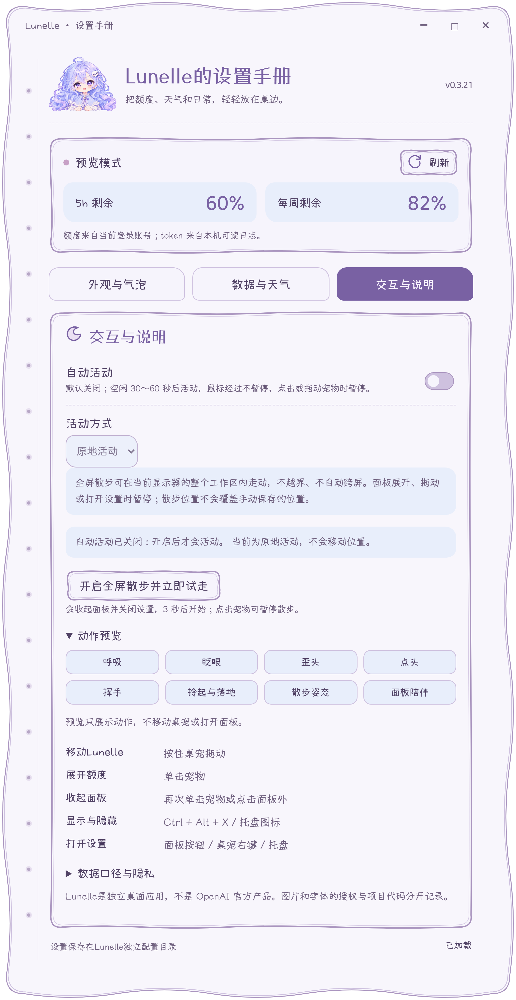
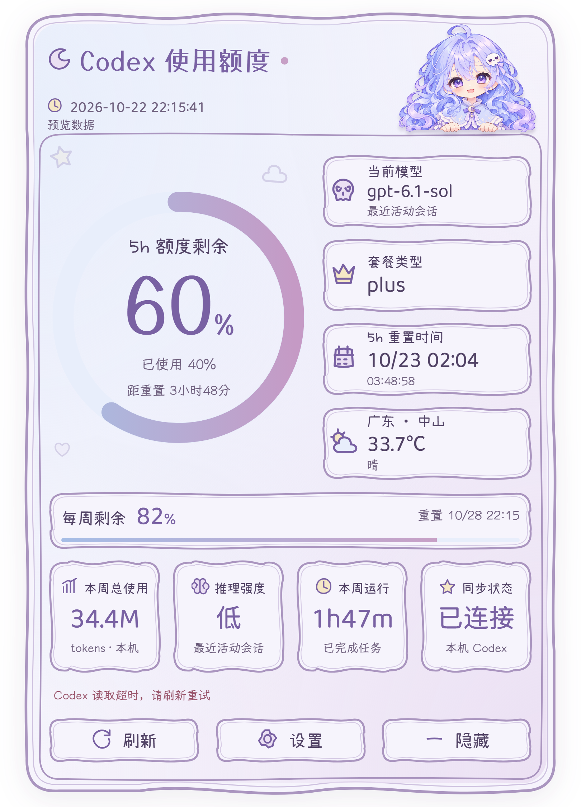

# Lunelle · 桌边画册

[查看六页安装手账的实机图](design/installer-final/README.md) · [批准的安装器角色分镜](design/installer-v2/README.md)

淡紫卷发绕过肩头，星星抱枕停在怀里。角色的表情、动作和手账界面，共同构成 Lunelle 的桌面日常。

[返回 README](../README.md) · [动作与播放说明](ANIMATION.md) · [素材许可](../ASSETS.md)

## 角色，先有一个安静的姿态

白袜、蓝紫色鞋子、月牙扣饰与骷髅蝴蝶结，在不同姿态里延续同一套细节。坐姿稿将睁眼与闭眼放在一起，便于对照面部表情和角色比例。

角色设计稿。点击图片可查看完整尺寸。

## 八个动作，一种气质

从呼吸、眨眼到歪头、挥手，再到拖动落地和散步，最初的概念稿记录了每个动作的方向。

原稿题字为项目曾用名 Xingyue。此图是设计参考，当前实现以实机截图与第 19 版散步资源为准。

## 悬空与落地

悬空时双腿蜷起、鞋底朝前；落地后回到并膝坐姿，裙摆舒展开来。两种姿势保留相同的服饰、发饰和星星抱枕。

下面是实际界面导出的两个动作相位：

<table>
<tr><th>悬空</th><th>回坐</th></tr>
<tr>
<td align="center"></td>
<td align="center"></td>
</tr>
</table>

## 表情与招呼

<table>
<tr><th>歪头</th><th>点头</th><th>挥手</th></tr>
<tr>
<td align="center"></td>
<td align="center"></td>
<td align="center"></td>
</tr>
</table>

<table>
<tr><th>睁眼</th><th>半闭</th><th>闭眼</th><th>半睁</th></tr>
<tr>
<td align="center"></td>
<td align="center"></td>
<td align="center"></td>
<td align="center"></td>
</tr>
</table>

本节均为运行相位图，静态展示不替代完整动画。

## 散步，保留选定的模样

当前使用第 19 版散步，每轮 1.08 秒。人物抱着星星侧向行走，画面保留原版的比例、裙摆和细微起伏。

这段动图与桌宠采用相同的画面和慢速节奏。腿部仍以八张关键姿势为基础，具有逐帧动画的节奏感；完整运行素材另含眨眼。

## 手账，延续角色的颜色

淡紫色线条、浅蓝色信息块和纸张白，让界面与角色处在同一组色调里。曲线纸边、装订孔和圆角滚动条构成手册细节。

<table>
<tr><th>额度手账</th><th>设置手册</th></tr>
<tr>
<td align="center" valign="top"></td>
<td align="center" valign="top"></td>
</tr>
</table>

查看动作预览入口与读取提示

界面截图由隔离演示数据生成，不代表真实账号。角色与设计图的权利说明见素材许可。
